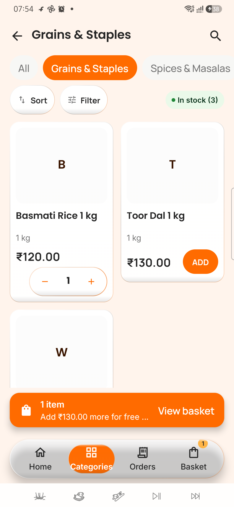
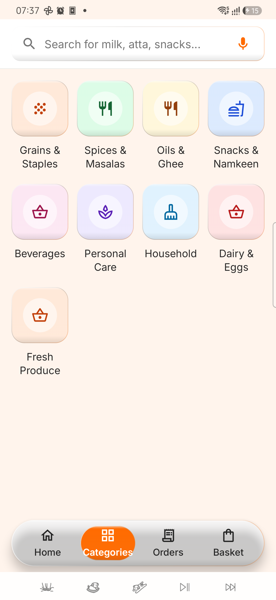
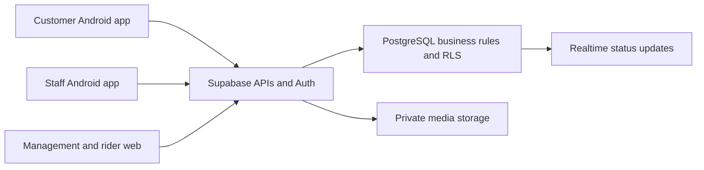

# Balaji Provision Store

**A native Android and web platform for grocery ordering, inventory, delivery workflows and billing.**

Balaji connects a customer's shopping app with the store's daily operations. Customers browse products and place orders; the store team manages catalogue, stock, fulfilment and counter sales against one shared backend.

**Stack:** Kotlin · Jetpack Compose · Next.js · React · TypeScript · PostgreSQL · Supabase

**Status:** functional development prototype, with production hardening and release validation ongoing. Cash-on-delivery workflows are implemented. Online payments remain disabled.

## Product overview

| Experience | Capabilities |
| --- | --- |
| Customer Android app | Product browsing, search, categories, basket, COD checkout, order status and access to own bills |
| Staff Android app | Store and delivery workflows with role-dependent actions |
| Management website | Catalogue and stock management, configurable service areas and delivery fees, staff provisioning, order fulfilment, delivery assignment and billing/POS |
| Delivery workflow | Assigned orders, controlled status transitions, dispatch/delivery proofs and COD collection |

The system supports weighted and packed products. Delivery charges are configurable; the delivery-charge threshold is not a minimum order requirement.

## Engineering highlights

- **Shared business rules:** PostgreSQL functions own pricing, fees, stock and order transitions. Mobile and web clients submit requests; client-supplied prices and totals are untrusted.
- **Safe checkout retries:** idempotency keys prevent a repeated submission from creating another order or deducting stock twice.
- **Consistent money and quantities:** money is stored in integer paise, and quantities use integer base units. Order and bill snapshots preserve historical prices when the catalogue changes.
- **Authorization by role and ownership:** customer, manager, staff and delivery workflows use row-level security and scoped server operations. Private media uses authorized signed URLs.
- **One operational workflow:** online orders, store fulfilment, delivery updates and POS billing share the backend and inventory. Realtime subscriptions support order-status synchronization.

## Android UI

| Product browsing | Categories |
| :---: | :---: |
|  |  |

Development captures from November 2026.

## Architecture



The Android clients use Kotlin, Jetpack Compose, Coroutines/Flow and Retrofit/OkHttp. The management website uses Next.js, React, TypeScript and Tailwind CSS. Supabase supplies PostgreSQL, authentication, storage and Realtime for the shared backend.

## Validation

Selected results from the local working checkout, November 22–23, 2026, using synthetic data:

| Check | Completed result |
| --- | --- |
| Android unit tests | 298 passed in each customer/staff × debug/release variant |
| Android build and lint | Four lint variants passed; direct and Play debug builds and distribution checks passed for both app flavors |
| Web tests | 48 passed |
| SMS hook tests | 20 passed with mocked providers |
| Optional gateway tests | 19 passed in each debug/release variant using fake SMS transport |
| Python tests | 8 passed |
| Local API integration | 18 order-lifecycle, 12 staff-API, 12 private-media and 15 security checks passed |
| Realtime and browser | Status-change delivery, catalogue rendering and order amount/status consistency passed on retry |

Release validation remains incomplete: web type/build checks and three database suites failed, and Android instrumented UI assertions remain unrun on the available test host. These are local validation results, not a production deployment or security certification.

## Reviewing the project

This project demonstrates Android UI and state management, TypeScript web development, PostgreSQL data modelling, transactional integrity and testing across application boundaries. Useful engineering discussion topics include duplicate checkout handling, stock consistency, weighted versus packed products, historical bill accuracy and authorization across multiple roles.

Project owner: [GuptaGKar](https://github.com/GuptaGKar).

<details>
<summary>Repository layout and local development</summary>

| Path | Purpose |
| --- | --- |
| `android/` | Kotlin/Compose customer and staff app flavors |
| `web/` | Next.js management, billing/POS and rider interfaces |
| `supabase/migrations/` | Database schema and server business rules |
| `supabase/tests/` | pgTAP database and authorization suites |
| `supabase/functions/` | Provider integration functions |
| `scripts/` | Local integration checks, distribution checks and business-rule guards |
| `docs/` | Implementation plan, decisions and development documentation |

Local development requires Node.js 20+, npm 10+, Docker, the Supabase CLI, and JDK 17 with Android SDK 36 for Android builds. Configure local Supabase settings using [`.env.example`](.env.example), and use synthetic data. Server-only credentials must remain on the server.

```bash
npm --prefix web ci
supabase start
npm --prefix web run dev
```

Configure the Android project's Supabase URL and public client key for the local test environment before running it. Open `android/` in Android Studio for the customer/staff flavors.

Common checks:

```bash
npm --prefix web test
npm --prefix web run lint
npm --prefix web run type-check
npm --prefix web run format:check
python3 -m unittest discover -s scripts/tests -v
bash scripts/check_guards.sh
supabase test db
```

See [CI](.github/workflows/ci.yml) for Android and distribution checks, the [implementation plan](docs/IMPLEMENTATION_PLAN.md) for intended behavior, and [QA history](QA_LOG.md) and [decisions](docs/DECISIONS.md) for development evidence.

</details>
